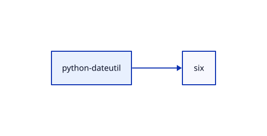

# Конфигурационное управление — вариант 21

Практическая работа № 2. Инструмент для визуализации зависимостей
Python-пакетов.

Реализованы **этапы 1–5**: CSV-конфигурация, нерекурсивный DFS,
порядок загрузки и визуализация D2. По умолчанию приложение создаёт
SVG и открывает его в браузере. Предыдущие этапы сохранены в `main`,
`stage-2`, `stage-3` и `stage-4`, текущий — в `stage-5`.

## Запуск

Нужен Python 3.9 или новее. Анализатор использует стандартную библиотеку.
Для создания изображения требуется внешний исполняемый файл D2.
Текстовый граф и порядок загрузки доступны без D2. Все команды
выполняются из корня репозитория.

```bash
python3 -m src.main
python3 -m src.main --config configs/test.csv
python3 -m src.main --config configs/test.csv --graph
python3 -m src.main --config configs/test.csv --order
```

В Windows вместо `python3` можно использовать `python` или `py -3`.
Сборка не требуется.
Для обращения к PyPI нужен доступ к сети.

`--config` задаёт путь к CSV, по умолчанию `configs/dateutil.csv`.
Этот пример выбран для короткого графа с зависимостью six.
Параметры пакета задаются в CSV. `--graph` включает списки смежности,
`--order` — порядок загрузки; эти режимы взаимоисключающие.
`--output` задаёт SVG-файл, `--d2` — путь к рендереру,
`--no-open` сохраняет изображение без открытия окна браузера.

## Конфигурация

Первая строка содержит имена столбцов, вторая — значения:

```csv
package,repository,test_mode,version
requests,https://pypi.org/pypi,false,2.32.3
```

| Параметр | Значение |
| --- | --- |
| `package` | Имя Python-пакета; в тестовом режиме — заглавные латинские буквы |
| `repository` | Базовый URL JSON API репозитория или путь к тестовому CSV |
| `test_mode` | `true` или `false`, регистр не важен |
| `version` | Версия пакета, например `1.2.3`, `2.0rc1`, `1.0.post1` |

Все четыре столбца обязательны. Порядок столбцов можно менять.
Дополнительные столбцы и строки, повторяющиеся имена столбцов,
пустые значения и повреждённый CSV считаются ошибками.
Используется UTF-8; допускается BOM. Пробелы по краям значений убираются.

В обычном режиме проверяется формат имени пакета и URL. Существование
пакета и указанной версии проверяется запросом к репозиторию.
В URL нельзя передавать пароль, query-параметры или fragment.
Версии могут содержать prerelease, postrelease, dev, epoch и local-часть.

В тестовом режиме файл должен существовать и быть доступен для чтения.
Относительный путь считается **от папки с CSV-конфигурацией**.
На третьем этапе файл читается целиком один раз, затем DFS обходит
достижимые из корня вершины. Имена узлов должны состоять из заглавных
латинских букв. Повторяющиеся строки и ссылки на отсутствующие узлы
считаются ошибками. Пустой список соседей допустим.

## Получение зависимостей

Для `requests` версии `2.32.3` выполняется запрос:

```text
GET https://pypi.org/pypi/requests/2.32.3/json
```

Используются `urllib.request` и `json` из стандартной библиотеки.
Основной анализатор не вызывает менеджеры пакетов и готовые библиотеки
получения зависимостей. Тайм-аут HTTP-запроса — 10 секунд.
Отдельный сценарий сравнения с pip устанавливает эталонные пакеты
во временный каталог; он не участвует в получении нашего графа.

Из ответа читается `info.requires_dist`. Для каждой записи выделяется имя
пакета. Регистр не учитывается, последовательности `.`, `_` и `-`
нормализуются к `-`, чтобы одно имя не создавало несколько вершин.
Записи с extras и условиями также включаются в граф: как на этапе 2,
условия не вычисляются для текущего окружения.

Версия из CSV фиксирует корневой пакет. Для дочерних пакетов используется
адрес `<repository>/<package>/json`, возвращающий метаданные последнего
релиза. Ограничения версий из Requires-Dist не используются для выбора
дочерних релизов. Это политика графа объявленных зависимостей; подбор
совместимого набора версий в этом этапе не реализован. Зависимости
с прямым URL после `@` приводят к явной ошибке.

Поле Requires-Dist, отсутствующее, равное `null` или пустому списку,
означает вершину без объявленных соседей. Она остаётся в графе
и выводится как `имя -> (none)`.

Поддерживаются PyPI и серверы с совместимым JSON API. URL Simple API
с окончанием `/simple` для этого способа получения данных не подходит.
Показываются сведения репозитория; wheel и sdist отдельно не разбираются.

Источники: [JSON API PyPI](https://docs.pypi.org/api/json/),
[Requires-Dist](https://packaging.python.org/en/latest/specifications/core-metadata/#requires-dist-multiple-use).

## Примеры

```bash
python3 -m src.main --config configs/dateutil.csv --graph
```

С `--graph` в stdout выводится достижимый граф. В режиме изображения
печатаются пути к D2 и SVG. При ошибке загрузки узла изображение
не создаётся, частичный граф не печатается.

Для тестового режима используется `configs/test.csv`:

```csv
package,repository,test_mode,version
A,../examples/repository.csv,true,1.0.0
```

В `examples/repository.csv` находится граф A → B, C; B → D; C → D.
Текстовый вывод для `configs/test.csv` с опцией `--graph`:

```text
A -> B, C
B -> D
D -> (none)
C -> D
```

D обрабатывается один раз. Порядок строк соответствует открытию вершин
DFS, а не порядку установки пакетов. В учебном CSV нет версий:
`version` проверяется, но не влияет на выбор строки.

Для `configs/cycle.csv` подготовлен цикл A → B → C → A:

```text
A -> B
B -> C
C -> A
Cycle: A -> B -> C -> A
```

Алгоритм хранит стек итераторов и текущий путь. Ребро к вершине текущего
пути замыкает цикл; ребро к завершённой вершине сохраняется без повторного
обхода. Поэтому общая зависимость двух ветвей не считается циклом.
Цикл является допустимым результатом, код завершения остаётся 0.
Записываются циклы, обнаруженные по обратным рёбрам DFS; все возможные
комбинации простых циклов отдельно не перечисляются.

Обход включает только достижимые вершины. Для локального файла вся
структура проверяется до обхода, включая несвязанные компоненты.

Дополнительные конфигурации:

| Файл | Случай |
| --- | --- |
| `configs/cycle.csv` | Цикл из трёх узлов |
| `configs/self_cycle.csv` | Самоссылка A → A |
| `configs/leaf.csv` | Одна вершина без зависимостей |
| `configs/disconnected.csv` | Несвязанные компоненты, обход только A и B |
| `configs/missing.csv` | Ошибка: у A зависимость Z без определения |

Сценарий демонстрации третьего этапа в ветке `stage-3`:

```bash
python3 scripts/demo_stage3.py
```

Скрипт последовательно открывает шесть локальных CSV-конфигураций.
Вывод выше описывает поведение графа. Сценарии демонстрации предыдущих
этапов следует запускать в соответствующих ветках.

## Порядок загрузки: этап 4

```bash
python3 -m src.main --config configs/test.csv --order
make order CONFIG=configs/test.csv
```

Для графа с общей зависимостью D порядок имеет вид `D -> B -> C -> A`.
Стек DFS сохраняет вершину в результат после обработки её зависимостей.
Каждый узел включается один раз, корень находится в конце.
Порядок между независимыми ветвями может различаться.

При цикле порядок не выводится: приложение завершает работу с кодом 1
и сообщает, какое ребро замкнуло цикл. Посмотреть сам граф с циклом можно
с `--graph` либо как изображение без `--order`. Несвязанные с корнем узлы
не включаются.

```bash
python3 scripts/demo_stage4.py
```

Сценарий использует общий узел, лист, несвязанные компоненты, цикл,
самоссылку и ошибку отсутствующей зависимости. Вывод демонстрации
сохранён в `reports/stage4/local-examples.txt`.

## Сравнение с pip

```bash
python3 -m scripts.compare_pip --config configs/dateutil.csv \
  --output reports/stage4/dateutil.json
```

Сначала наш код строит граф и порядок. Затем pip независимо устанавливает
wheel-пакеты в новый временный каталог с `--ignore-installed --target`.
Каталог удаляется после сравнения. Последовательность берётся из строки
`Installing collected packages`, а не из алфавитного `Successfully installed`.
Сравниваются состав, точная последовательность и порядок общих рёбер.
Сценарий поддерживает PyPI и TestPyPI; для локальных буквенных графов
сравнение с реальным менеджером не применяется.

Полученные результаты на Python 3.9:

| Конфигурация | Наш порядок | Порядок pip | Результат |
| --- | --- | --- | --- |
| `dateutil.csv` | six → python-dateutil | six → python-dateutil | Совпадает |
| `dotenv.csv` | click → python-dotenv | python-dotenv | Дополнительный узел click |
| `six.csv` | six | six | Совпадает |

Для python-dotenv click объявлен под extra `cli`. Наш граф включает все
объявления, а pip без extras его не устанавливает. Также расхождения
возможны из-за маркеров окружения и выбора совместимых версий pip:
в нашем графе для дочерних пакетов читается последний релиз.
Разные последовательности независимых узлов допустимы, если каждое
ребро сохраняет правило «зависимость раньше потребителя».

Фактические журналы pip и сравнения находятся в `reports/stage4/*.json`.
Правило порядка установки pip описано в его
[документации](https://pip.pypa.io/en/stable/cli/pip_install/#installation-order).

## Визуализация: этап 5

Установите D2 по [официальной инструкции](https://d2lang.com/tour/install/).
Исполняемый файл ищется по `--d2`, затем в PATH и в `.tools/d2`.
Служебная папка `.tools` не входит в репозиторий.

```bash
python3 -m src.main --config configs/test.csv \
  --output build/test.svg
python3 -m src.main --config configs/cycle.csv \
  --output build/cycle.svg --no-open
```

Сначала создаётся соседний `.d2`, затем запускается `d2 --layout=dagre`.
При успешном рендеринге SVG открывается в стандартном браузере.
Для сервера без графического интерфейса используется `--no-open`.
При невозможности открыть браузер файл остаётся доступен по напечатанному
пути. Ошибка рендерера или его отсутствие даёт код завершения 1.

Идентификаторы D2 имеют вид n0, n1, а имена пакетов задаются отдельными
строковыми метками. Поэтому дефисы в именах не меняют синтаксис диаграммы.
Корень выделяется голубым, рёбра обнаруженных циклов — красным.
Отдельная вершина без рёбер также попадает в изображение.

Подготовлены реальные изображения трёх пакетов:

| Пакет | D2 | Изображение |
| --- | --- | --- |
| python-dateutil 2.9.0.post0 | [dateutil.d2](examples/visualizations/dateutil.d2) | [dateutil.svg](examples/visualizations/dateutil.svg) |
| python-dotenv 1.0.1 | [dotenv.d2](examples/visualizations/dotenv.d2) | [dotenv.svg](examples/visualizations/dotenv.svg) |
| six 1.17.0 | [six.d2](examples/visualizations/six.d2) | [six.svg](examples/visualizations/six.svg) |



## Сравнение с pipdeptree

Для сравнения структуры используется pipdeptree — отдельный инструмент
показа дерева установленных Python-пакетов. В основном анализаторе он
не импортируется и не вызывается. Собственный граф формируется до
получения эталонных данных.

Служебное окружение для сравнения создаётся отдельно:

```bash
python3 -m venv .tools/reference
.tools/reference/bin/python -m pip install pipdeptree==2.23.4
python3 -m scripts.demo_stage5 --no-open
```

В Windows интерпретатор находится в `.tools/reference/Scripts/python.exe`.
Другой интерпретатор с pipdeptree задаётся через `--reference-python`.
Для открытия трёх готовых изображений уберите `--no-open`.
Без эталонного инструмента отдельную диаграмму можно создать обычным CLI.

Сценарий сначала сохраняет наш D2 и SVG. Затем pip устанавливает пакет
во временную папку, а pipdeptree читает её через PYTHONPATH отдельного
подпроцесса. Сохраняются текстовое дерево, JSON-дерево и разница узлов
и направленных рёбер. Временные установленные пакеты удаляются.

В `reports/stage5/` находятся фактические сравнения с pipdeptree 2.23.4:

| Пакет | Сравнение структуры |
| --- | --- |
| python-dateutil | Совпадают корень, six и ребро между ними |
| python-dotenv | Наш граф содержит дополнительное ребро к click |
| six | Одна вершина без зависимостей в обоих представлениях |

Разница для python-dotenv объясняется extra `cli`, как в сравнении этапа 4.
Диаграмма показывает все опубликованные объявления, а эталонное дерево —
фактически установленные зависимости текущего окружения. Сравнивается
структура имён и рёбер; совместимость версий дочерних пакетов наш код
по-прежнему не разрешает.

Формат экспорта описан в [документации D2](https://d2lang.com/tour/exports/),
возможности эталонного инструмента — в
[репозитории pipdeptree](https://github.com/tox-dev/pipdeptree).

Например, при `test_mode=yes` приложение сообщает:

```text
Error: test_mode must be true or false
```

Коды завершения: `0` — граф построен, `1` — ошибка файла,
параметра или репозитория, `2` — неверные аргументы командной строки.
Ошибки HTTP, сети и метаданных выводятся в stderr с префиксом `Error:`.
Для отсутствующего пакета или версии: `Error: Package or version not found`.
При ошибке частичный граф не печатается.

## Тесты

```bash
python3 -m venv .venv
source .venv/bin/activate
python -m pip install -r requirements-dev.txt
python -m pytest tests/ -q
```

В PowerShell окружение активируется командой `.venv\Scripts\Activate.ps1`.

Сохранены тесты предыдущих этапов; ожидания CLI обновлены для вывода
графа. Интеграционные тесты используют HTTP-сервер на `127.0.0.1`,
доступа к PyPI не требуют. `pytest` используется только для тестов.
Автотесты этапов 4 и 5 не запускались. Демонстрационные результаты
и сравнения с pip приведены отдельно от тестового набора.

При наличии `make` доступны команды:

```bash
make run
make run CONFIG=configs/test.csv
make order CONFIG=configs/test.csv
make test
make demo
```

При необходимости интерпретатор можно задать через `PYTHON`, например
`make test PYTHON=.venv/bin/python`.

## Файлы и функции

- `src/main.py`: `main()` разбирает `--config`, обрабатывает ошибки;
  `parse_args()` читает режим; `print_graph()` выводит граф и циклы.
- `src/config.py`: `Config.__init__()` сохраняет настройки;
  `Config.get_info()` возвращает их словарём; `read_csv()` проверяет
  структуру CSV; `load_config()` загружает и проверяет конфигурацию.
- `src/validators.py`: `parse_test_mode()` преобразует boolean;
  `check_package()` проверяет имя; `check_version()` — версию;
  `check_url()` и `check_url_fields()` — адрес;
  `check_repository()` выбирает проверку URL или локального файла.
- `src/repository.py`: `build_release_url()` создаёт URL версии;
  `fetch_metadata()` запрашивает JSON; `parse_dependencies()` читает
  Requires-Dist; `get_dependencies()` выбирает источник данных.
- `src/test_repository.py`: `read_test_dependencies()` находит прямых
  соседей; `read_test_repository()` читает и проверяет весь локальный CSV.
- `src/pypi_repository.py`: `normalize_name()` объединяет варианты имени;
  `requirement_name()` извлекает имя из Requires-Dist;
  `PyPIRepository.get_children()` получает соседей из JSON API.
- `src/graph.py`: `build_graph()` выполняет DFS без рекурсии;
  `load_graph()` выбирает источник данных и начинает обход.
- `src/order.py`: `get_load_order()` строит порядок завершения DFS
  и отклоняет циклический граф.
- `src/visualization.py`: `graph_to_d2()` задаёт узлы и рёбра;
  `render_graph()` сохраняет D2 и SVG; `show_image()` открывает изображение;
  `find_d2()` находит рендерер, `get_cycle_edges()` выделяет циклы.
- `scripts/compare_pip.py`: `collect_comparison()` собирает реальный
  результат pip и сохраняет отчёт через `main()`.
- `scripts/pip_tools.py`: запуск pip в отдельный каталог, чтение его
  последовательности и сравнение порядков.
- `tests/`: тесты загрузчика, проверок параметров, репозитория и CLI.
- `scripts/demo_stage4.py`: `main()` показывает порядок на локальных графах.
- `scripts/demo_stage5.py`: создание трёх изображений и сравнение
  с деревьями pipdeptree.
- `configs/`: параметры для PyPI и локальных примеров.
- `examples/`: CSV-графы, включая пример с ошибкой.

## Следующие этапы

| Этап | Задача | Состояние |
| --- | --- | --- |
| 1 | CSV-конфигурация и минимальный CLI | Реализован в `main` |
| 2 | Прямые зависимости Python-пакета указанной версии | Реализован в `stage-2` |
| 3 | Нерекурсивный DFS, транзитивные зависимости и циклы | Реализован в `stage-3` |
| 4 | Порядок загрузки зависимостей и сравнение с pip | Реализован в `stage-4` |
| 5 | Описание графа на D2 и показ изображения | Реализован в `stage-5` |

Готовые менеджеры пакетов и библиотеки получения зависимостей
для реализации анализатора не используются.
